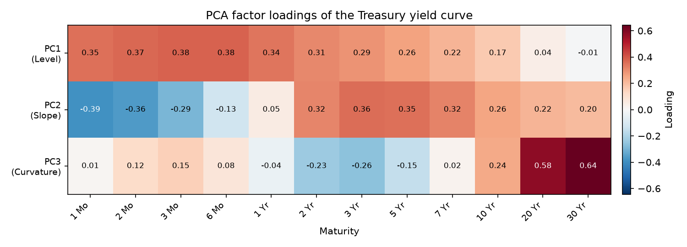
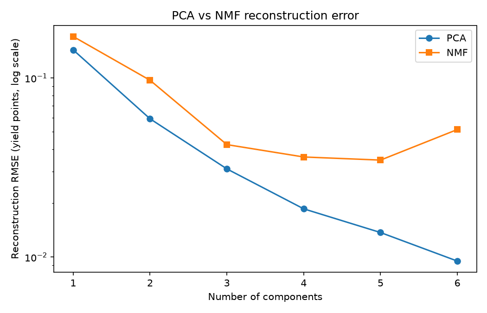

# How many factors drive the US Treasury yield curve?

*Origin: Originally developed for the AI for Finance course at KAIST (Spring 2023); refactored and open-sourced in July 2026.*

A short empirical study. Twelve par yield tenors move every trading day, from 1 month out to 30 years. The question this repository answers with code: how few linear factors reproduce essentially all of that movement, and does a nonnegative factorization, which is forced to build curves from nonnegative parts, tell the same level, slope, curvature story that principal components do?

Everything below reproduces offline in about 30 seconds from a committed 400-day sample of real Treasury data:

```
python -m venv .venv
.venv\Scripts\activate      # Windows, or: source .venv/bin/activate
pip install -e ".[dev]"
python scripts/analyze.py   # PCA + NMF on data/treasury_sample.csv, no network
python scripts/compare.py   # reconstruction-error sweep, k = 1..6
```

## Question

The term-structure literature holds that three factors, level, slope, and curvature, explain nearly all daily yield curve variation. Two specific things are tested here:

1. Does plain PCA on mean-centered daily par yields recover those three shapes, and how much variance does each carry on a recent window?
2. NMF factorizes the raw nonnegative panel into nonnegative basis curves with nonnegative weights, a more physically interpretable decomposition for yields. How much reconstruction accuracy does that interpretability cost at matched component counts?

## Method

- Data: daily US Treasury par yield curve rates, 12 maturities, public domain US government data. A 400-row sample (2024-12-03 to 2026-07-10), carved from a live download, is committed at `data/treasury_sample.csv` so the study runs with no network. `scripts/download_data.py` fetches the full multi-year panel, and the loader falls back to cache, then to a synthetic Nelson-Siegel generator, so nothing here ever hard-fails offline.
- PCA: fit on the mean-centered panel with no variance scaling, so loadings stay in yield units. Component signs are normalized to a positive mean, making level uniformly positive and runs reproducible.
- NMF: fit on the raw panel (yields are nonnegative), NNDSVDA initialization, fixed seed.
- Ablation: both models are refit at k = 1..6 components and compared by reconstruction RMSE in yield points. Full tables in [RESULTS.md](RESULTS.md), machine-readable copy in `results/metrics.json`.

## Findings

Three components explain 98.4 percent of daily variance on the committed sample (level 0.666, slope 0.278, curvature 0.041). On the full 880-day 2023-2026 download the same three shapes appear with cumulative 0.988 (level 0.774, slope 0.174, curvature 0.041), so the structure is stable across windows even though the level-slope split shifts.

The loading heatmap is the whole result in one picture: PC1 loads with one sign across the curve (level), PC2 flips sign between short and long tenors (slope), PC3 is a butterfly, positive wings against a negative belly (curvature).



On the accuracy cost of nonnegativity: PCA beats NMF at every matched k, which is expected, since PCA with its mean term is the optimal linear rank-k approximation. The gap at k = 3 is small, 0.031 vs 0.042 RMSE in yield points on the sample. NMF error is also not monotone in k (it worsens from k = 5 to 6 on the sample), a local-optimum artifact of the nonconvex NMF objective, reported as observed.



So the answer to the title question: three, and the nonnegative decomposition broadly agrees while paying a small, quantified accuracy premium.

## Limitations

- Descriptive, not predictive. No forecasting, no trading signals, no zero-curve bootstrapping; this decomposes par yields as published.
- US daily data only, and the committed sample covers a single 19-month window. Factor shares (level vs slope) are window-dependent, as the sample vs full-panel comparison in RESULTS.md shows.
- NMF results depend on initialization and seed at larger k. The reported numbers fix both; other seeds land in other local optima.
- Synthetic fallback data is a Nelson-Siegel simulation for demos and tests, and is never mixed into reported results.

## Repository layout

```
src/yieldcurve/       data loading, PCA and NMF decompositions, metrics IO
scripts/              analyze.py (heatmap, scree, metrics), compare.py (k-sweep), download_data.py
data/                 committed treasury_sample.csv, full downloads gitignored
results/              committed figures and metrics.json, regenerated by the scripts
notebooks/demo.ipynb  executed walkthrough on the committed sample
tests/                pytest suite, fully offline (PCA vs SVD checks, loader, NMF)
RESULTS.md            all measured numbers with reproduction commands
```

Verification: `pytest -q` (38 tests, offline) and `ruff check .`.

## Author

Aamir Malik

- GitHub: https://github.com/aamirmalik-dr
- LinkedIn: https://linkedin.com/in/dr-aamirmalik

## License

MIT, see LICENSE.
